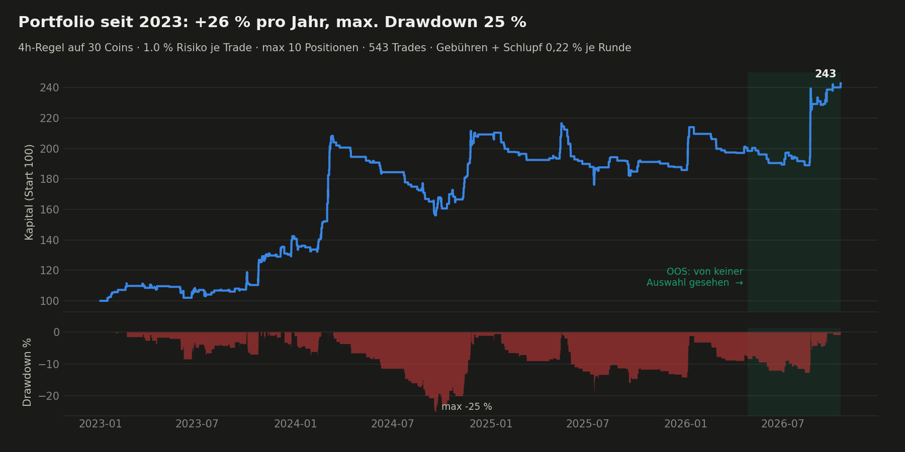

<p align="center">
  
</p>

> 🚧 **Baustelle:** Dieser Bot ist aktuell **nicht live** und wird weiterentwickelt.

# JaegerBot v5 — ANN-Ensemble, Live = Backtest


Vollautomatischer Futures-Bot für **Bitget**. Ein neuronales Netz (Ensemble aus 3 MLPs je Seite) sagt für jede geschlossene Kerze voraus, ob der Kurs das Gewinnziel (4 × ATR) vor dem Stop (2 × ATR) erreicht. Gehandelt werden nur die stärksten Vorhersagen, im Aufwärtstrend, auf etablierten Coins.

Neu aufgebaut am 25.10.2026. Der alte jaegerbot (v4) verlor live, weil sein Backtest nicht echt war (siehe [Warum v4 verlor](#warum-v4-verlor)).

---

## Was der Bot gerade handelt

| | |
|---|---|
| Regel | **Long**, nur die stärksten **1 %** der ANN-Vorhersagen, nur wenn EMA20 > EMA50 |
| Timeframe | **4h** |
| Coins | 39 etablierte Coins (Bitget-Listing ≥ 1200 Tage, ≥ 1 Mio. USDT Tagesvolumen) |
| Ausstieg | TP 4 × ATR, SL 2 × ATR (beide hängen an der Einstiegsorder), sonst Zeitausstieg nach 12 Kerzen |
| Risiko | 0,95 % des realisierten Kapitals je Trade (höchstes Risiko mit Drawdown ≤ 30 % seit 2023), max. 20 Positionen, ein Coin nur einmal |
| Kosten im Backtest | 0,06 % Gebühr + 0,05 % Schlupf je Seite (0,22 % pro Runde) |

Das aktuelle Team steht in `settings.json` (`active_strategies`), die Regeln mit IS/OOS-Zahlen zeigt `./show_results.sh`.


*Ein echter Trade aus den letzten 26 Wochen: Das Modell, das dieses Signal gab, wurde nur mit Kerzen vor Quartalsbeginn trainiert. Unten die ANN-Wahrscheinlichkeit „TP vor SL“; gehandelt wird nur über der Schwelle (stärkste 1 %) und nur, wenn EMA20 über EMA50 liegt.*

## Ehrliche Zahlen

Alle Vorhersagen sind **Walk-Forward**: Für jedes Quartal gibt es ein eigenes Modell, das nur mit Kerzen trainiert wurde, deren Ausgang vor Quartalsbeginn feststand. Kein Modell kennt die Kerzen, die es vorhersagt.

| Messung (Stand 25.10.2026) | Ergebnis |
|---|---|
| Portfolio seit 01.01.2023, 0,95 % Risiko | **+34,5 %/Jahr, max. Drawdown 30 %**, 698 Trades, +0,20 R je Trade, schlechtestes Jahr −14 % |
| davon OOS (letzte 26 Wochen, von keiner Auswahl gesehen) | +52 %, Drawdown 7 % |
| Kontrollgruppe: zufällige Longs im Aufwärtstrend, gleiche Ausstiege | −0,03 R je Trade (ANN-Signale der 4h-Regel +0,23 R) |
| Gleiche Regel auf jungen Altcoins | ≈ 0 R, deshalb nur etablierte Coins |
| Shorts | auf großen Coins durchgehend negativ, deshalb nur Long |



*Die Kurve ist nicht glatt: Gewinne kommen in Trendphasen (Anfang 2024, Ende 2024, Herbst 2026), dazwischen liegen lange Seitwärts- und Rückgangsphasen. Der Drawdown ist auf geschlossene Trades gerechnet.*


*Die Kante steckt im Modell und nicht nur im Trend: Zufällige Longs im selben Aufwärtstrend mit denselben Ausstiegen verlieren auf allen drei Timeframes.*

**Warum nicht 20–40 einzeln optimierte Coin-Configs wie beim fibot?** Getestet: Die Auswahl je Coin × Timeframe bestätigte 20 Configs mit Backtest „+185 %/Jahr“. Mit **Zufalls-Vorhersagen** bestätigte dieselbe Methode 4–13 Configs mit +99 bis +278 %/Jahr; die Zahlen sind also reiner Auswahleffekt. Rückversetzt (Auswahl bis 26.04.2026, dann 26 Wochen vorwärts) brachte die Auswahl je Coin **−2 %**, die einheitliche Regel **+22 %**.


Realistische Erwartung: eher die rund +35 %/Jahr über die ganze Zeit als die letzten 26 Wochen. Die Kante ist klein und braucht Aufwärtstrends.

**Mehr Rendite nur mit mehr Risiko** (gleiche Regel, gleiche Trades, nur größere Positionen, seit 2023):

| Risiko je Trade | Rendite pro Jahr | max. Drawdown | schlechtestes Jahr |
|---|---|---|---|
| **0,95 % (aktiv)** | **+35 %** | **30 %** | **−14 %** |
| 1,5 % | +54 % | 43 % | −23 % |
| 2 % | +71 % | 53 % | −30 % |
| 3 % | +99 % | 69 % | −43 % |
| 4 % | +119 % | 79 % | −55 % |

Der Drawdown ist auf geschlossene Trades gerechnet; mit Buchverlusten offener Positionen ist er höher. Ändern: `risk_per_trade_pct` in `settings.json` (die Quartals-Pipeline setzt es wieder auf das höchste Risiko mit DD ≤ `max_drawdown_pct`).

---

## Wie der Bot sich selbst prüft


| Prüfung | Wann | Was passiert bei Fehler |
|---|---|---|
| **Datenprüfung** (`utils/data_check.py`): Lücken, veraltete letzte Kerze, Mindestlänge, kaputte Preise | Download, Training, Optimizer, jeder Live-Einstieg | Coin fliegt aus Training/Configs, live kein Einstieg (Ausstiege laufen weiter) |
| **Paritätstest** (`tests/parity_check.py`): Live-Entscheidung auf 600-Kerzen-Fenster = Backtest-Signal auf voller Historie (Kerze, Richtung, SL, TP) | jede Quartals-Pipeline, täglich (30 Kerzen), `run_tests.sh` | Pipeline gilt als fehlgeschlagen → Rücksicherung |
| **Live-Zyklus gegen Schein-Börse** (`tests/test_trade_cycle.py`) | `run_tests.sh` | Test rot |
| **Modellprüfung**: Schwellen geordnet in (0, 1), genug Trainingslabels | jede Quartals-Pipeline | Rücksicherung |
| **Täglicher Selbstcheck** (`daily_self_check.py`, ab 08:00 UTC per Telegram): Live-Trades der letzten 7 Tage gegen Backtest (gleich / fehlt live / nur live / Ausstieg), Positionen ohne Stop-Loss, verwaiste Positionen, Modell fürs laufende Quartal vorhanden, Datenzustand | täglich | Warnung in Telegram |

**Sicherung:** Vor jeder Quartals-Pipeline werden Modelle, Configs und `settings.json` nach `artifacts/backups/<Zeitpunkt>/` gesichert (die letzten 6 bleiben). Scheitert ein Schritt oder eine Prüfung, wird der alte Stand automatisch zurückgespielt; der Bot handelt dann mit dem Vorquartal-Modell weiter.

---

## Ablauf

```
Cron alle 15 Min ──> master_runner.py
                      ├─ Durchgang 1: Ausstiege aller Strategien (SL/TP ausgelöst? Haltedauer um?)
                      ├─ Durchgang 2: Einstiege in fester Reihenfolge (wie der Simulator)
                      ├─ startet auto_optimizer_scheduler.py (prüft selbst: neues Quartal?)
                      └─ startet daily_self_check.py      (prüft selbst: heute schon gelaufen?)

Quartalsbeginn ──> auto_optimizer_scheduler.py
                      Sicherung → download_data → walkforward (neues Quartalsmodell)
                      → Modellprüfung → optimizer (Regel je Timeframe, IS-Wahl, OOS-Bestätigung)
                      → run_portfolio_optimizer (Timeframes + Risiko, DD ≤ 30 % seit 2023)
                      → Paritätstest → Telegram   (bei Fehler: Rücksicherung + Alarm)
```

Geprüft werden jedes Quartal **1h, 2h, 4h, 6h und 1d**. Eine Regel kommt nur dazu, wenn sie im OOS ≥ +10 % bei ≤ 30 % Drawdown und ≥ 10 Trades erreicht und das Portfolio verbessert. Am 25.10.2026 bestanden 1h und 4h (zusammen 69 bestätigte Coin-Strategien); 1h erhöhte im Portfolio nur den Drawdown, deshalb laufen die 39 Strategien auf 4h.


## Eine Logik für alles

`src/jaegerbot/strategy/trade_rules.py` ist die einzige Stelle für Signal, SL/TP, Positionsgröße, Hebel, Ausstieg und Kosten. Live (`utils/trade_manager.py`), Backtest und Portfolio-Simulation (`analysis/backtester.py`, ein Ereignis-Durchlauf für beides) rufen nur diese Funktionen auf. Die Features (`strategy/features.py`) nutzen nur Rolling-Fenster; ein Live-Fenster von 600 Kerzen ergibt dieselben Vorhersagen wie der Backtest auf Jahren (gemessen: Abweichung ≤ 3·10⁻⁸).

## Dateien

| Datei | Zweck |
|---|---|
| `master_runner.py` | Live-Lauf aller Strategien (Cron) |
| `src/jaegerbot/strategy/trade_rules.py` | einzige Handelslogik |
| `src/jaegerbot/strategy/features.py`, `model.py` | Features, ANN-Ensemble, Quartalsmodelle |
| `src/jaegerbot/utils/trade_manager.py` | Live-Zyklus einer Strategie |
| `src/jaegerbot/analysis/walkforward.py` | Quartalsmodelle trainieren, Vorhersagen schreiben |
| `src/jaegerbot/analysis/backtester.py` | Backtest und Portfolio-Simulation |
| `src/jaegerbot/analysis/optimizer.py` | Regel je Timeframe (IS-Wahl, OOS-Bestätigung) |
| `run_portfolio_optimizer.py` | Timeframes + Risiko fürs Live-Team |
| `auto_optimizer_scheduler.py` | Quartals-Pipeline mit Sicherung und Prüf-Tor |
| `daily_self_check.py` | täglicher Telegram-Selbstcheck |
| `download_data.py` | Kerzen-Cache + `artifacts/db/data_health.json` |
| `artifacts/models/<tf>/ensemble_<Quartal>.joblib` | Modelle (im Repo, damit Live = Backtest-Datei) |
| `docs/make_illustrations.py` | erzeugt die Bilder dieser README aus echten Daten neu (`python docs/make_illustrations.py`) |

---

## Installation (VPS)

```bash
git clone <repo> jaegerbot && cd jaegerbot
./install.sh
nano secret.json          # {"jaegerbot": [{"name": "...", "apiKey": "...", "secret": "...", "password": "..."}],
                          #  "telegram": {"bot_token": "...", "chat_id": "..."}}
nohup .venv/bin/python3 download_data.py > logs/download.log 2>&1 &   # einmalig, einige Stunden
```

Cronjob (`crontab -e`):

```cron
*/15 * * * * /usr/bin/flock -n /pfad/zu/jaegerbot/jaegerbot.lock /bin/sh -c "cd /pfad/zu/jaegerbot && .venv/bin/python3 master_runner.py >> logs/cron.log 2>&1"
```

Das Konto muss im **Hedge-Modus** laufen. Mindestgröße bei Bitget: 5 USDT je Order. Der Stop liegt im Median bei 4,4 % (10 % der Signale über 12 %), eine Order ist bei 0,95 % Risiko also meist 8–22 % des Kapitals. Gemessen seit 2023: mit 30 USDT Start wären 299 Signale an der Mindestgröße gescheitert, mit 50 USDT 139, mit **100 USDT keines**. Der Simulator und der tägliche Selbstcheck rechnen die Mindestgröße genauso mit.

## Update

```bash
./update.sh
```

Behält `secret.json`, das live laufende Team und — falls der VPS seit dem letzten Push selbst nachtrainiert hat — dessen neuere Modelle und Configs. **Beim Umstieg von v4 zweimal ausführen** (der erste Lauf ist noch das alte Skript).

## Nützliche Befehle

```bash
./show_results.sh                                     # Regeln, Team, Portfolio-Kennzahlen
./run_tests.sh                                        # Offline-Tests + Paritätstest (keine echten Orders)
./run_pipeline.sh                                     # Quartals-Pipeline sofort (mit Sicherung)
.venv/bin/python3 daily_self_check.py --force --send  # Selbstcheck sofort
tail -f logs/cron.log logs/jaegerbot_*_4h.log
```

---

## Warum v4 verlor

1. Das ANN wurde auf dem ganzen Zeitraum trainiert; der „OOS“-Teil des Optimizers lag in den Trainingsdaten → Schein-Bestätigung.
2. OBV wurde über die ganze Historie aufsummiert: live (500 Kerzen) sah das Modell andere Eingaben als im Training.
3. Shorts waren kein eigenes Modell, sondern „Long-Modell sagt kein TP“.
4. Der Backtest kappte Verluste auf das Risiko, ccxt 4.3.5 lieferte abgeschnittene Historien, 500 Optuna-Versuche je Config wählten Zufallstreffer.
5. `run_tests.sh` setzte echte PEPE-Orders ab (vermutlich die PEPE-Mikro-Trades im August 2026).

Alte v4-Configs liegen in `src/jaegerbot/strategy/configs_alt_v4/`, der alte Code in der Git-Historie.
