# JaegerBot v5 — Long + Short, Chart lesen wie ein Mensch

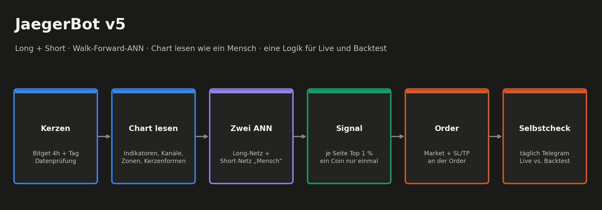

Vollautomatischer Futures-Bot für **Bitget** (USDT-Perpetuals, 4h-Kerzen) mit zwei neuronalen Netzen:

- **Long-Netz** — 46 Indikator-Merkmale; handelt die stärksten 1 % der Long-Signale, nur im Aufwärtstrend.
- **Short-Netz „Mensch“** — liest den Chart wie ein Trader: Kanäle, Marktstruktur, Trendlinien, Zonen, Ausbruch/Retest und 28 Kerzenformen, jeweils auf 4h **und** Tageschart (158 Merkmale); handelt die stärksten 1 % der Short-Signale.

Beide Netze laufen auf einem Konto, auf 39 etablierten Coins, jeder Coin ist nur einmal belegt. Jede Order trägt Stop-Loss und Gewinnziel schon beim Einstieg.

| Kurz gesagt (Stand 25.10.2026, Bot-Simulator mit Kosten, Mindestorder und Margin) | |
|---|---|
| seit 01.01.2023 | **+73 % pro Jahr**, größter Rückgang 29 % |
| 100 USDT ab 01.05.2026 (nur ungesehene Daten) | **205 USDT** heute, größter Rückgang 8,8 % |
| Jahre 2023 / 2024 / 2025 / 2026 | +67 % / +83 % / −4 % / +177 % |
| Live = Backtest | Paritätstest 39/39 Long und 39/39 Short identisch |

---

## Inhalt

1. [So handelt der Bot](#so-handelt-der-bot)
2. [Beispiel: 100 USDT ab 01.05.2026](#beispiel-100-usdt-ab-01052026)
3. [Ehrliche Zahlen](#ehrliche-zahlen)
4. [Long-Seite](#long-seite)
5. [Short-Seite „Mensch“](#short-seite-mensch)
6. [Wie der Bot sich selbst prüft](#wie-der-bot-sich-selbst-prüft)
7. [Ablauf und Aufbau](#ablauf-und-aufbau)
8. [Installation, Start, Update](#installation-start-update)
9. [Forschung: was getestet wurde](#forschung-was-getestet-wurde)
10. [Warum v4 verlor](#warum-v4-verlor)

---

## So handelt der Bot

| | Long | Short |
|---|---|---|
| Profil | `trend` | `mensch` |
| Signal | stärkste **1 %** der Long-Vorhersagen, nur wenn EMA20 > EMA50 | stärkste **1 %** der Short-Vorhersagen |
| Merkmale | 46 Indikatoren (Rolling-Fenster) | 46 Indikatoren + Kanäle + Chart-Geometrie + Kerzenformen, 4h und Tag |
| Coins | 39 etablierte Coins (Bitget-Listing ≥ 1200 Tage, ≥ 1 Mio. USDT Tagesvolumen) | dieselben 39 |
| Einstieg | Market-Order nach Kerzenschluss, SL und TP hängen an der Order | ebenso |
| Ausstieg | TP 4 × ATR oder SL 2 × ATR, sonst nach 12 Kerzen (48 h) | ebenso |

Gemeinsam: **1,40 % Risiko** des realisierten Kapitals je Trade, höchstens **20 Positionen**, jeder Coin nur einmal, bei gleichzeitigem Signal Long vor Short. Kosten im Backtest: 0,06 % Gebühr + 0,05 % Schlupf je Seite (0,22 % pro Runde).

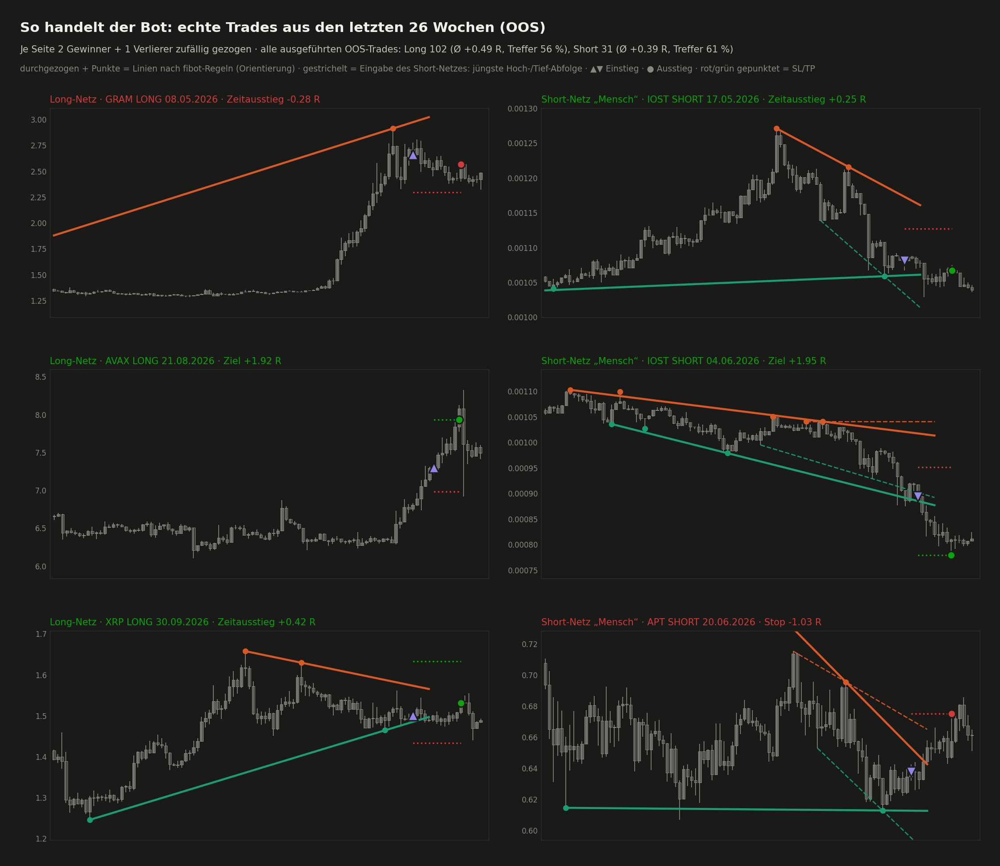

*Sechs Trades, die der Bot in den letzten 26 Wochen mit den Live-Einstellungen ausgeführt hätte — je Seite zwei Gewinner und ein Verlierer, zufällig gezogen. Durchgezogene Linien mit Punkten: Trendlinien nach fibot-Regeln als Lesehilfe. Gestrichelt: was das Short-Netz tatsächlich als Eingabe nutzt (jüngste Hoch-/Tief-Abfolge).*

## Beispiel: 100 USDT ab 01.05.2026

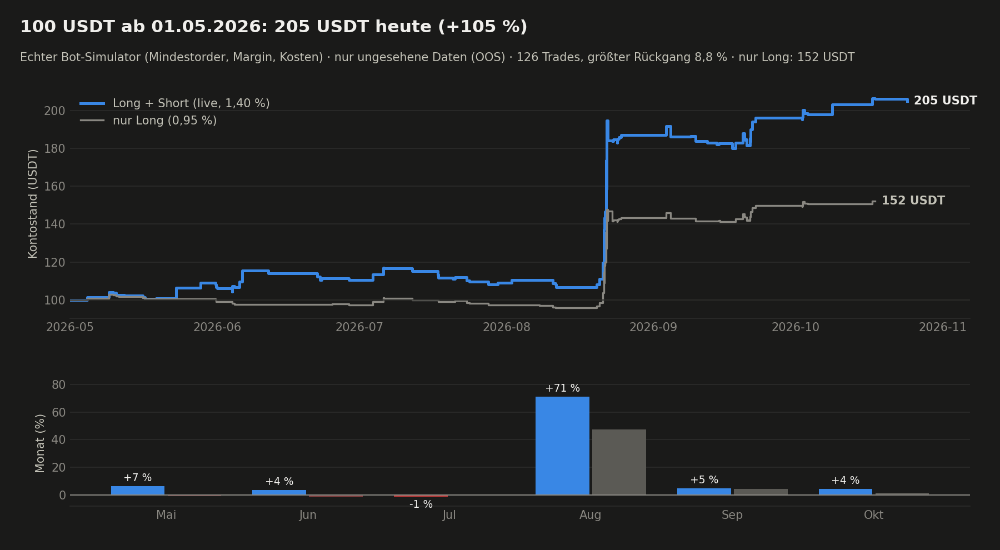

| Monat | Kontostand (Long + Short) | Monat |
|---|---|---|
| Mai | 106,59 USDT | +7 % |
| Juni | 110,51 USDT | +4 % |
| Juli | 109,15 USDT | −1 % |
| **August** | **186,91 USDT** | **+71 %** |
| September | 196,12 USDT | +5 % |
| Oktober (bis 25.) | 204,77 USDT | +4 % |

126 Trades (102 Long, 24 Short), Trefferquote 56 %, größter Rückgang 8,8 %, tiefster Kontostand 100,61 USDT. Nur Long hätte 152 USDT ergeben. **Wichtig:** Der Großteil kam aus der August-Rally; ohne sie wären Mai bis Juli rund +9 % gewesen. Die Short-Seite hat genau dort geholfen, wo Long stillstand (Mai–Juli: Long allein −3 %, zusammen +9 %).

## Ehrliche Zahlen

Alle Vorhersagen sind **Walk-Forward**: Für jedes Quartal gibt es ein eigenes Modell, das nur mit Kerzen trainiert wurde, deren Ausgang vor Quartalsbeginn feststand. Kein Modell kennt die Kerzen, die es vorhersagt. „OOS“ = die letzten 26 Wochen, die bei keiner Auswahl benutzt wurden.

| Messung | Ergebnis |
|---|---|
| Long + Short seit 01.01.2023, 1,40 % Risiko | **+73 %/Jahr**, größter Rückgang 29 %, 1084 Trades |
| davon OOS (26 Wochen) | **+110 %**, größter Rückgang 9 % |
| nur Long, 0,95 % Risiko | +34,5 %/Jahr, Rückgang 30 %, 2025: −14 % |
| Long-Signale gegen zufällige Longs im Aufwärtstrend | +0,23 R gegen −0,03 R je Trade |
| gleiche Long-Regel auf jungen Altcoins | ≈ 0 R → nur etablierte Coins |
| Shorts aus dem Long-Netz | negativ → eigenes Short-Netz |
| ein gemeinsames Netz für Long und Short | +15 %/Jahr → zwei Spezialisten |

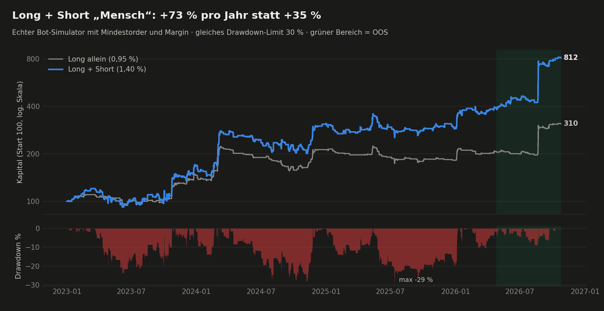

*Die Kurve ist sprunghaft: Gewinne kommen in Schüben (Anfang 2024, Ende 2024, August 2026), dazwischen liegen lange zähe Phasen. Der Rückgang ist auf geschlossene Trades gerechnet; live mit Buchverlusten offener Positionen ist er zwischendurch höher.*

**Mehr Rendite nur mit mehr Risiko** (gleiche Trades, nur größere Positionen, seit 2023):

| Risiko je Trade | Rendite pro Jahr | größter Rückgang |
|---|---|---|
| 0,95 % | +49 % | 21 % |
| 1,20 % | +62 % | 26 % |
| **1,40 % (aktiv)** | **+73 %** | **29 %** |
| 1,50 % | +79 % | 31 % |

Höher lohnt sich nicht: tiefe Verlustphasen schaden überproportional (beim Long-Bot allein brach die Rendite ab ~1,5 % Risiko ein, bei 2,5 % waren es −45 %/Jahr bei 98 % Rückgang). Ändern: `risk_per_trade_pct` in `settings.json`.

**Mindestorder:** Bitget verlangt 5 USDT je Order. Der Stop liegt im Median 4,3 % vom Einstieg (10 % der Signale über 11,8 %). Mit 1,40 % Risiko wären seit 2023 bei 30 USDT Start 88 Signale an der Mindestorder gescheitert, bei 50 USDT 3, **ab 75 USDT keines**.

## Long-Seite

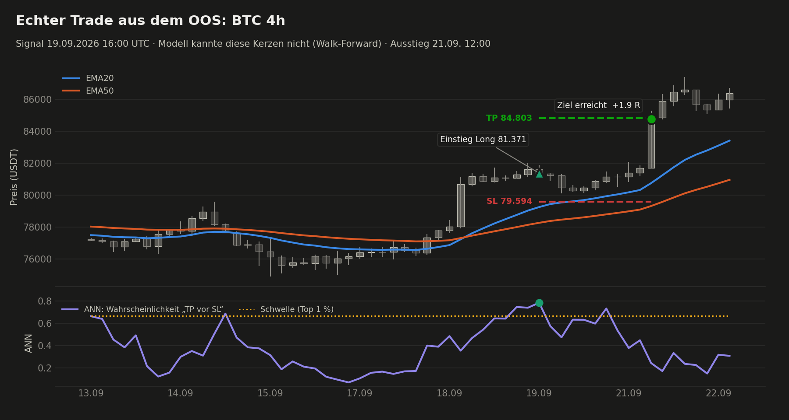

*Das Modell, das dieses Signal gab, wurde nur mit Kerzen vor Quartalsbeginn trainiert. Gehandelt wird nur über der Schwelle (stärkste 1 %) und nur, wenn EMA20 über EMA50 liegt.*

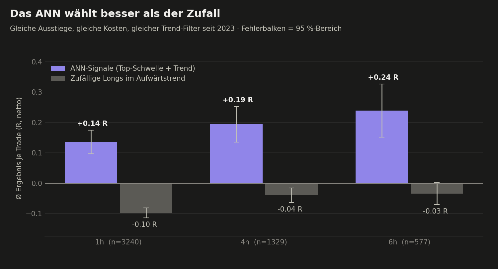

*Die Kante steckt im Modell, nicht nur im Trend: Zufällige Longs im selben Aufwärtstrend mit denselben Ausstiegen verlieren auf allen drei Timeframes.*

Jedes Quartal werden die Long-Regeln für **1h, 2h, 4h, 6h und 1d** neu geprüft (im IS gewählt, im OOS bestätigt: ≥ +10 %, Rückgang ≤ 30 %, ≥ 10 Trades). Bestätigt sind 1h und 4h; 1h erhöhte im Portfolio nur den Rückgang, deshalb läuft 4h.

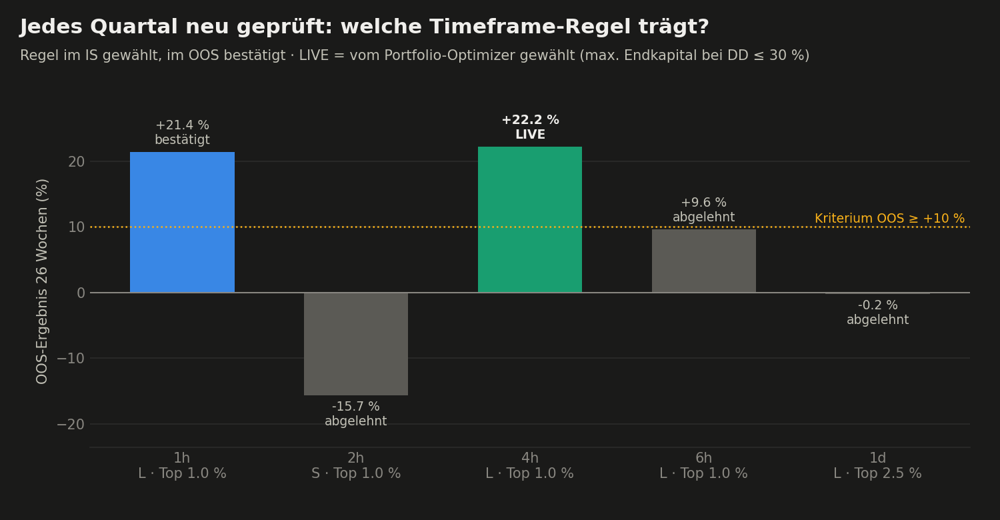

**Warum eine Regel für alle Coins statt 20–40 einzeln optimierter Configs (wie beim fibot)?** Die Auswahl je Coin × Timeframe bestätigte 20 Configs mit Backtest „+185 %/Jahr“ — mit **Zufalls-Vorhersagen** schaffte dieselbe Methode +99 bis +278 %/Jahr. Rückversetzt (Auswahl bis 26.04.2026, dann 26 Wochen vorwärts) brachte die Auswahl je Coin −2 %, die einheitliche Regel +22 %.

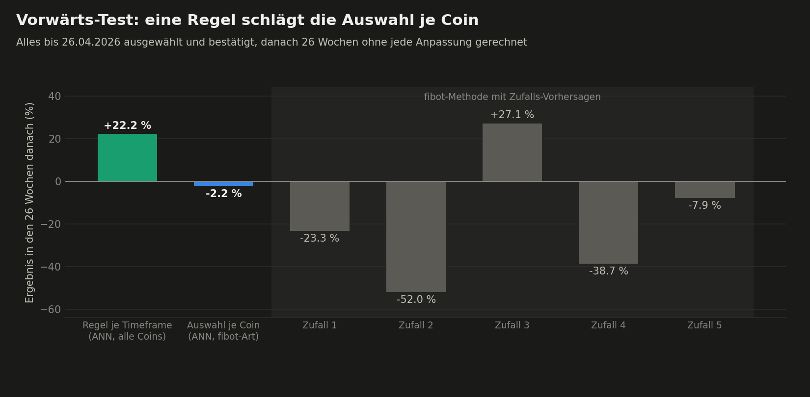

## Short-Seite „Mensch“

Das Short-Netz bekommt zusätzlich zu den Indikatoren, was ein Trader im Chart sieht — auf 4h und auf Tageskerzen (nur abgeschlossene Tage):

| Gruppe | Was das Netz sieht | Modul |
|---|---|---|
| Kanäle | Regressions-Kanal über 50 und 150 Kerzen: Steigung relativ zur Breite (flach / steigend / fallend), Geradlinigkeit, Lage im Kanal, Breite, Berührungen | `strategy/features.py` |
| Marktstruktur | höhere/tiefere Hochs und Tiefs aus bestätigten Pivots | `strategy/human_geometry.py` |
| Hoch-/Tief-Abfolge | Linie durch die letzten zwei Pivot-Hochs bzw. -Tiefs: Steigung, Abstand, Dreieck/Keil | `strategy/human_geometry.py` |
| Zonen | horizontale Unterstützungen/Widerstände aus gebündelten Pivots: Abstand, Berührungen | `strategy/human_geometry.py` |
| Muster | Doppel-Hoch/-Tief, Ausbruch über/unter Zone, Retest | `strategy/human_geometry.py` |
| Kerzenformen | Hammer, Shooting Star, Doji-Arten, Marubozu, Pin-Bar, Engulfing, Harami, Piercing, Dark Cloud, Tweezer, Inside/Outside Bar, Kicker, Morgen-/Abendstern, drei Soldaten/Krähen | `strategy/candle_patterns.py` |

Ein Pivot zählt erst, wenn er bestätigt ist (4h: 5 Kerzen später, Tag: 3 Tage) — so wie ein Mensch ihn auch erst dann erkennen kann.

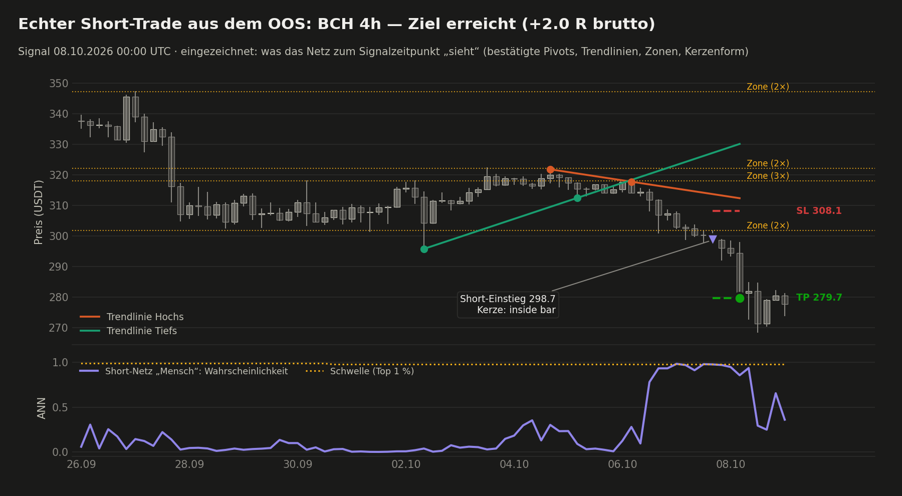

*Ein echter Short aus den letzten 26 Wochen: fallender Kanal mit drei Berührungen am Widerstand, mehrfach berührte Zonen, Inside Bar als Signalkerze. Durchgezogene Linien sind die Trendlinien, wie ein Mensch sie zeichnet (fibot-Regeln, Punkte = Berührungen); gestrichelt ist, was das Netz als Eingabe bekommt (jüngste Hoch-/Tief-Abfolge). Unten die Short-Wahrscheinlichkeit des Netzes — gehandelt wird nur über der Schwelle (stärkste 1 %).*

**Wie „Mensch“ ausgewählt wurde** (vorregistriert, `forschung/kanal_varianten/PREREG.md`): sechs Varianten mit je einer Änderung, nur im IS verglichen (Long-Seite immer die Live-Regel), danach einmal OOS. Kerzenformen allein schadeten; erst zusammen mit der Chart-Geometrie wurde das Netz stark. Ein gemeinsames Netz für Long und Short war deutlich schwächer.

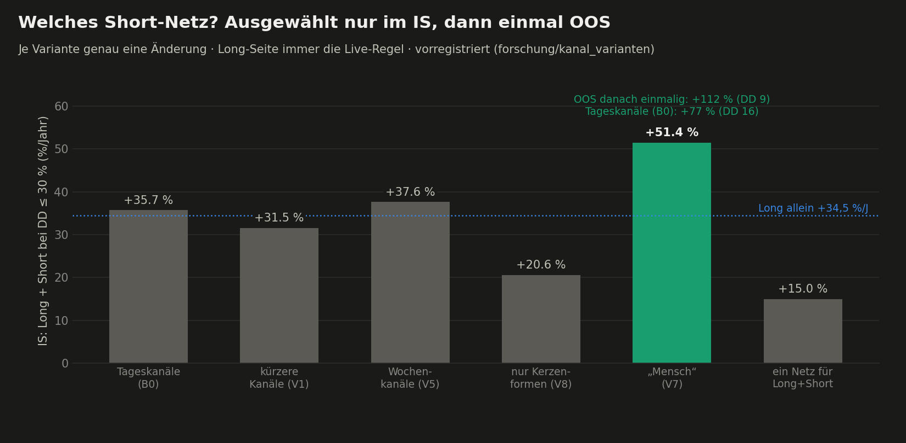

**Schöne Linien gegen schnelle Hoch-/Tief-Abfolge:** Eine Variante (V9) bekam statt der kurzen Hoch-/Tief-Linien saubere Trendlinien nach fibot-Regeln (≥ 2 Berührungen, kein Schlusskurs-Bruch, höchstens 6 ATR vom Kurs). Die Linien sehen menschlicher aus, das Netz wurde damit aber schwächer (IS +45 statt +51 %/Jahr, und es wählte Long statt Short). Live bleibt deshalb V7.

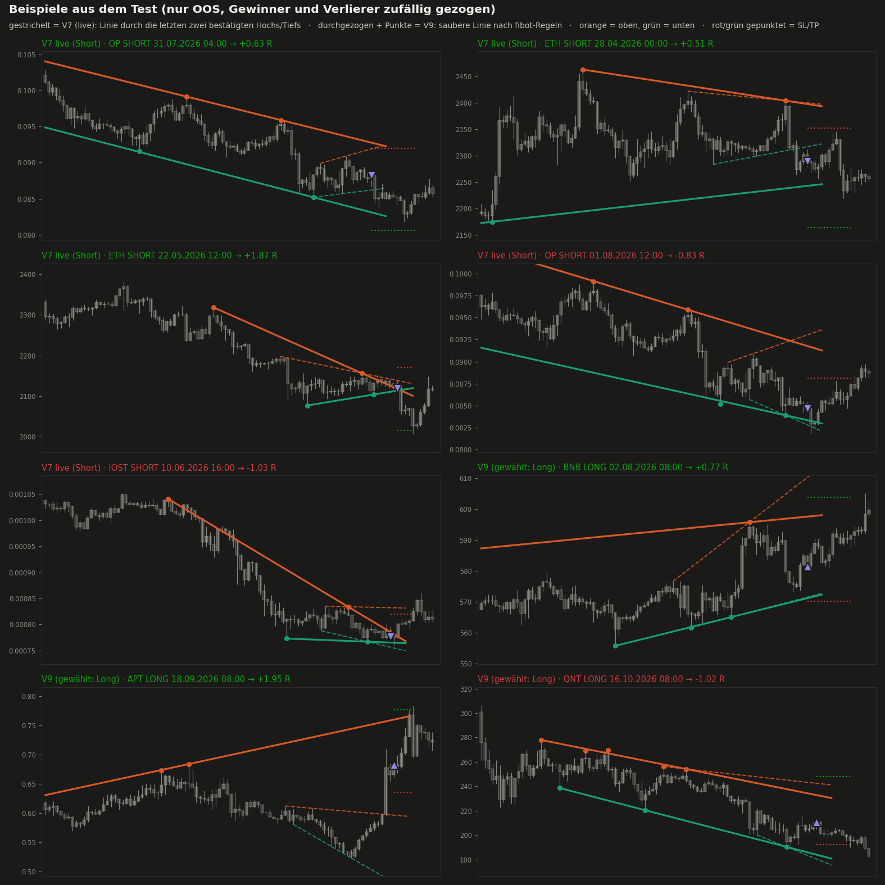

*OOS-Bilanz aller Signale: V7 59 Shorts, Ø +0,45 R, Treffer 59 % — V9 100 Longs, Ø −0,10 R, Treffer 43 %.*

## Wie der Bot sich selbst prüft

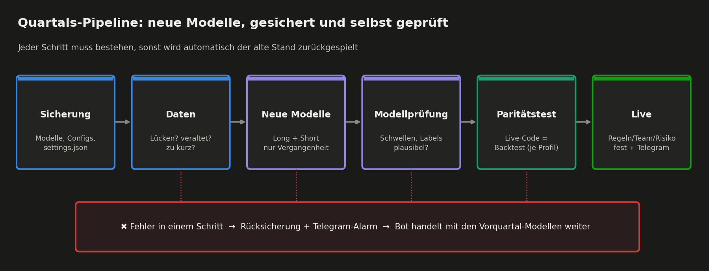

| Prüfung | Wann | bei Fehler |
|---|---|---|
| **Datenprüfung** (`utils/data_check.py`): Lücken, veraltete letzte Kerze, Mindestlänge, kaputte Preise | Download, Training, jeder Live-Einstieg | Coin fliegt aus dem Training; live kein Einstieg (Ausstiege laufen weiter) |
| **Paritätstest** (`tests/parity_check.py`): Live-Entscheidung auf dem Live-Fenster (Long 600, Short 1300 Kerzen) = Backtest-Signal auf voller Historie (Kerze, Richtung, SL, TP) | Quartals-Pipeline (je Profil), täglich (12 Kerzen), `run_tests.sh` | Pipeline gilt als fehlgeschlagen → Rücksicherung; täglich: Warnung |
| **Live-Zyklus gegen Schein-Börse** (`tests/test_trade_cycle.py`): Order-Richtung, SL/TP, Größe, Ausstieg, Symbol-Sperre | `run_tests.sh`, für Long und Short | Test rot |
| **Modellprüfung**: Schwellen geordnet, genug Trainingslabels | Quartals-Pipeline | Rücksicherung |
| **Täglicher Selbstcheck** (`daily_self_check.py`, ab 08:00 UTC per Telegram): Live-Trades der letzten 7 Tage gegen Backtest beider Profile, Positionen ohne Stop-Loss, verwaiste Positionen, Modelle fürs laufende Quartal, Datenzustand | täglich | Warnung in Telegram |

**Sicherung:** Vor jeder Quartals-Pipeline werden Modelle und Configs beider Seiten sowie `settings.json` nach `artifacts/backups/<Zeitpunkt>/` gesichert (die letzten 6 bleiben). Scheitert ein Schritt, wird der alte Stand zurückgespielt und der Bot handelt mit den Vorquartal-Modellen weiter.

## Ablauf und Aufbau

```
Cron alle 15 Min ──> master_runner.py   (je Profil ein Unterprozess: trend = Long, mensch = Short)
                      ├─ Durchgang 1: Ausstiege aller Strategien (SL/TP ausgelöst? Haltedauer um?)
                      ├─ Durchgang 2: Einstiege, erst Long, dann Short, in fester Reihenfolge (wie der Simulator)
                      ├─ startet auto_optimizer_scheduler.py (prüft selbst: neues Quartal?)
                      └─ startet daily_self_check.py      (prüft selbst: heute schon gelaufen?)

Quartalsbeginn ──> auto_optimizer_scheduler.py
                      Sicherung → Kerzen nachladen → neues Quartalsmodell je Profil (nur Vergangenheit)
                      → Modellprüfung → Paritätstest je Profil → Telegram
                      Regeln, Team und Risiko bleiben fest   (bei Fehler: Rücksicherung + Alarm)
```

**Eine Logik für alles:** `src/jaegerbot/strategy/trade_rules.py` ist die einzige Stelle für Signal, SL/TP, Positionsgröße, Hebel, Ausstieg und Kosten. Live (`utils/trade_manager.py`), Backtest und Portfolio-Simulation (`analysis/backtester.py`) rufen nur diese Funktionen auf. Alle Merkmale nutzen nur Rolling-Fenster und bestätigte Pivots; das Live-Fenster ergibt dieselben Vorhersagen wie der Backtest auf Jahren.

| Datei | Zweck |
|---|---|
| `master_runner.py` | Live-Lauf aller Strategien beider Profile (Cron) |
| `src/jaegerbot/strategy/trade_rules.py` | einzige Handelslogik, Profile (`trend`, `mensch`) |
| `src/jaegerbot/strategy/features.py` | Merkmale je Profil (Indikatoren, Kanäle, Tageskanäle) |
| `src/jaegerbot/strategy/human_geometry.py` | Marktstruktur, Linien, Zonen, Muster, saubere Linien (Forschung) |
| `src/jaegerbot/strategy/candle_patterns.py` | Kerzenformen-Bibliothek |
| `src/jaegerbot/strategy/model.py` | ANN-Ensembles, Quartalsmodelle |
| `src/jaegerbot/utils/trade_manager.py` | Live-Zyklus einer Strategie |
| `src/jaegerbot/analysis/walkforward.py` | Quartalsmodelle trainieren, Vorhersagen schreiben |
| `src/jaegerbot/analysis/backtester.py` | Backtest und Portfolio-Simulation |
| `src/jaegerbot/analysis/optimizer.py`, `run_portfolio_optimizer.py` | Regel je Timeframe, Portfolio und Risiko (Long-Einzelteam) |
| `auto_optimizer_scheduler.py` | Quartals-Pipeline mit Sicherung und Prüf-Tor |
| `daily_self_check.py` | täglicher Telegram-Selbstcheck |
| `download_data.py` | Kerzen-Cache + `artifacts/db/data_health.json` |
| `artifacts/models/`, `artifacts/models_mensch/` | Quartalsmodelle Long/Short (im Repo, damit Live = Backtest-Datei) |
| `src/jaegerbot/strategy/configs/`, `configs_mensch/` | Configs Long/Short |
| `docs/make_illustrations.py` | erzeugt die Bilder dieser README aus echten Daten |
| `forschung/` | vorregistrierte Tests mit Skripten und Ergebnissen |

## Installation, Start, Update

**Neu installieren:**

```bash
git clone <repo> jaegerbot && cd jaegerbot
./install.sh
nano secret.json          # {"jaegerbot": [{"name": "...", "apiKey": "...", "secret": "...", "password": "..."}],
                          #  "telegram": {"bot_token": "...", "chat_id": "..."}}
```

**Vom alten Stand aktualisieren und starten:**

```bash
./update.sh && ./update.sh                                   # zweimal beim Umstieg von v4 (erster Lauf = altes Skript)
.venv/bin/python3 daily_self_check.py --force --send         # Telegram: "Team 78 (trend, mensch)", "Paritaet 78/78"
nohup .venv/bin/python3 download_data.py --timeframes 4h > logs/download.log 2>&1 &   # einmalig, für Selbstcheck + Pipeline
crontab -e                                                   # Zeile unten eintragen → der Bot handelt
```

```cron
*/15 * * * * /usr/bin/flock -n /pfad/zu/jaegerbot/jaegerbot.lock /bin/sh -c "cd /pfad/zu/jaegerbot && .venv/bin/python3 master_runner.py >> logs/cron.log 2>&1"
```

Voraussetzungen: Konto im **Hedge-Modus**, mindestens **75–100 USDT**. Eröffnungen erscheinen in Telegram als `jaegerbot …` (Long) bzw. `jaegerbot[mensch] …` (Short). Jede Eröffnung und jede Schließung kommt **mit Chart-Bild**: Kerzen, Einstieg, SL/TP, beim Long EMA20/50, beim Short Trendlinien, Zonen und Kerzenform, darunter die ANN-Wahrscheinlichkeit gegen die Schwelle; beim Schließen zusätzlich Ausstieg und Ergebnis in R. Scheitert das Bild, kommt die Meldung als Text – der Handel selbst wird davon nie berührt.

`./update.sh` behält `secret.json`, das live laufende Team und — falls der VPS selbst nachtrainiert hat — dessen neuere Modelle und Configs beider Seiten.

**Nützliche Befehle:**

```bash
./run_tests.sh                                        # Offline-Tests + Paritätstest, Long und Short (keine echten Orders)
./show_results.sh                                     # Regeln und Kennzahlen der Long-Seite
./run_pipeline.sh                                     # Quartals-Pipeline sofort (mit Sicherung)
.venv/bin/python3 daily_self_check.py --force --send  # Selbstcheck sofort
tail -f logs/cron.log logs/jaegerbot_*_4h.log logs/jaegerbot_*_4h_mensch.log
```

## Forschung: was getestet wurde

Alle Tests mit festgelegten Kriterien **vor** der Rechnung, Skript und Ergebnis in `forschung/<Thema>/`:

| Thema | Idee | Ergebnis |
|---|---|---|
| `kanal_varianten` | Short-Netz mit Kanälen, Wochen-/Tageskanälen, Chart-Geometrie, Kerzenformen; saubere fibot-Linien (V9) | **„Mensch“ (V7) gewählt und bestätigt** — jetzt live; V9 schwächer |
| `ann_kanaltypen` | Kanal-Geometrie als ANN-Eingaben (4h, + Tageskanäle) | Short-Kante gefunden, allein zu schwankend → Grundlage für „Mensch“ |
| `seitwaerts` | eigenes ANN für den Seitwärtsmarkt (v1, v2 nur in Seitwärtsphasen) | nicht bestanden: keine Kante gegenüber Zufall |
| `pairs` | Pair-Trading (Cointegration) | nicht bestanden: brutto null, netto klar negativ |
| `geometrie` | am Rand flacher Kanäle handeln; Trend-Signale im Kanal auslassen | nicht bestanden: Ränder brechen öfter aus, als sie halten |
| `fibo_geometrie` | fibot-Kanäle als Filter bzw. fibot-Setups + ANN | nicht bestanden: Ausbrüche aus flachen/fallenden Kanälen sind die besten Long-Trades |

## Warum v4 verlor

1. Das ANN wurde auf dem ganzen Zeitraum trainiert; der „OOS“-Teil des Optimizers lag in den Trainingsdaten → Schein-Bestätigung.
2. OBV wurde über die ganze Historie aufsummiert: live (500 Kerzen) sah das Modell andere Eingaben als im Training.
3. Shorts waren kein eigenes Modell, sondern „Long-Modell sagt kein TP“.
4. Der Backtest kappte Verluste auf das Risiko, ccxt 4.3.5 lieferte abgeschnittene Historien, 500 Optuna-Versuche je Config wählten Zufallstreffer.
5. `run_tests.sh` setzte echte PEPE-Orders ab (vermutlich die PEPE-Mikro-Trades im August 2026).

Alte v4-Configs liegen in `src/jaegerbot/strategy/configs_alt_v4/`, der alte Code in der Git-Historie.
